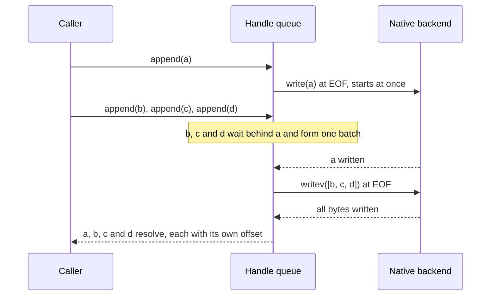
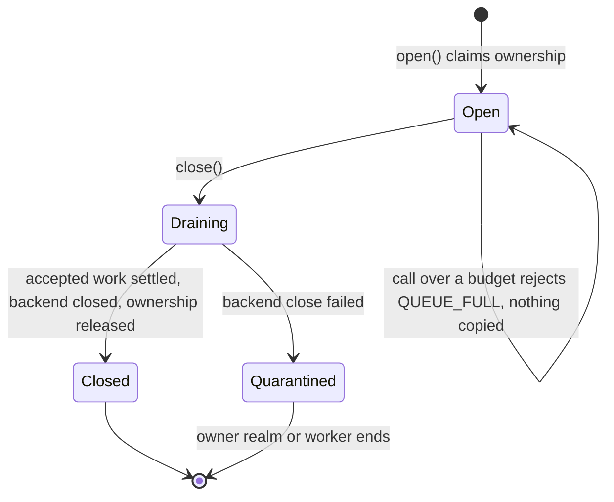

# Architecture

## Package boundary

`defuss-storage` owns bytes and file-handle lifecycle. DSON owns encoding and
framing. DBSONL owns live-record resolution, log recovery and persistent indexes.
DB/graph own their schemas and access paths; DataView owns query execution over
logical record sources. There is no runtime dependency between these layers.

## Modules

- `types.ts`: platform-neutral public contracts and capabilities.
- `errors.ts`, `validate.ts`: error normalization and input/size/name checks.
  The same condition maps to the same code on every adapter: a directory under
  a valid name is `UNSUPPORTED` on native files (lstat) and OPFS
  (`TypeMismatchError`).
- `file.ts`: one serial operation queue per handle, or overlapping reads within
  a `maxReadBytes` budget for read-only native handles; admission (operation and
  write-byte reservations); size tracking; append batching over an optional
  vectored backend write; partial-I/O completion; independent input/output
  buffers; borrowed-window revalidation; streams that read one chunk ahead of
  slow consumers; the opt-in write buffer; buffer hand-off (`transfer`).
- `streams.ts`: `appendChunks` with an optional in-flight window, built only on
  the public `StorageFile` API.
- `memory.ts`: bounded geometric in-memory file buffers and adapter-local owners.
- `node.ts`: FileHandle I/O on libuv's thread pool, or synchronous calls on the
  same descriptors (`io: "sync"`), and canonical-path ownership shared by ESM/CJS
  through a versioned global symbol in one JS realm. No multi-process lock claim.
- `opfs.ts`: dedicated-worker sync-access handles; per-file origin Web Locks held
  through close. Removing files participates in the same ownership protocol.
- `custom.ts`: supported constructor for third-party byte backends.
- `index.ts`: memory and common API only; no native imports or I/O at import
  time. The packed-consumer test walks this entry's module graph to enforce it.

## Ordering and lifecycle

All accepted operations on one handle execute in invocation order. EOF selection
and append stay in the same queue task, preventing same-handle append races.
Read-only native handles are the exception: they have no writes to order
against, so reads start in call order and run concurrently on libuv's thread
pool while their lengths together fit `maxReadBytes`. Why that budget instead of
the operation limit: 1,024 overlapping reads could each allocate up to
`maxReadBytes`; the byte budget keeps the allocation bound of a serial queue.
Waiting reads keep call order, so a large read is never starved by small ones.

Appends that queue up behind a running operation form a batch; when the first
one's turn comes, it writes the whole batch at EOF with one vectored backend
write, and the others report the outcome it recorded. Any other operation
queued between appends ends the batch, so a batch never jumps ahead of one.
Why this design: each native call costs about 8 µs of thread-pool round trip,
so throughput depends on bytes per call. VERIFIED: (raw probes, 4 KiB, macOS
arm64) a `writev` of 16 buffers cost 1.0 µs per buffer against 8.9 µs for one
awaited write each; 16 concurrent `pwrite` calls at disjoint offsets cost
7.6 µs each, and a larger thread pool did not help. A timer that waits to
collect appends (Nagle-style) would delay a lone append; `setTimeout(0)` alone
measured 1.1 ms in Node.js. Batching only what is already queued adds no wait.
Outcomes stay per append: a member resolves once all its bytes are confirmed;
a failing call fails every member it carried, because any of their bytes may
have landed; a member cancelled between partial writes fails alone, and the
members after it, which no call has carried yet, are written by the next
batch. Backends without `writev` (memory, OPFS) never batch.

The write buffer is opt-in per handle (`writeBuffer` bytes). Appends that fit
are copied into one buffer, written by one backend call when it fills and at
the start of any task that reads, overwrites, truncates, flushes or closes. On
an idle handle with a known size such an append completes without queuing:
nothing queued can observe it before the next task drains the buffer. Why
draining before a read rather than serving reads from the buffer: one code path
for every read, and the read sees bytes the file really holds. Why opt-in:
buffered bytes are invisible to other processes and lost on a crash until
written, and a failed buffer write can only be reported by the later operation
that triggered it, after the appends already resolved. Such a failure discards
the buffered bytes, since any prefix may have landed, and the handle queries its
size again. `close()` drains, closes the backend whatever the drain did, and
then rejects with the drain error, so ownership is released.

`transfer: true` moves the input's ArrayBuffer to the handle instead of copying
it. VERIFIED: (probe) a 1 MiB copy costs 24 µs, taking the buffer 0.1–0.9 µs
(`ArrayBuffer.prototype.transfer`; Node.js 20 lacks it, and a `structuredClone`
transfer moves the buffer in 0.6–2.2 µs). The view must cover its whole buffer,
because detaching a larger buffer would break the caller's other views of it,
such as Node's shared pool behind small `Buffer`s. Admission precedes the move,
so a call rejected with `QUEUE_FULL` keeps its buffer.

`io: "sync"` runs the native backend's calls synchronously on the descriptor of
the same FileHandle. VERIFIED: (probe, 4 KiB) writeSync 3.4 µs and readSync
0.8 µs against 8.9 and 7.6 µs through the thread pool. It blocks the calling
thread, so it is an option for worker threads and CLIs, not the default. A
dedicated I/O worker that owns the files would need a message round trip per
operation and a cross-realm ownership protocol; a worker that creates its own
synchronous adapter needs neither. VERIFIED: (packed-consumer check, Node.js
20, 24 and 26, Bun 1.4.3) a worker thread running this mode passes the
consumer's checks, and the main thread's 5 ms timer keeps firing during the
worker's 200 ms of blocking writes. Read-only handles in this mode do not
overlap reads, since each read blocks the thread anyway.

The handle tracks the file size instead of asking the backend before each
append or read. VERIFIED: (probe, native) that query is an `fstat` thread-pool
round trip as long as the I/O it precedes. Within the ownership contract the
handle is the only writer, so it follows its own writes, appends and
truncations exactly. A failed mutation can leave partial progress, and a short
read shows a writer outside the contract; both make it ask the backend again.
Read and write loops handle short native operations; a zero-progress write
rejects instead of spinning. A synchronous backend completes the read loop
without an intermediate async promise, switching to an async continuation only
when a backend returns one. This avoids a promise allocation and scheduling hop
per chunk without changing public operation promises or queue ordering. The
alternative, one always-async loop, is shorter but added 31–59 ns per memory
read in interleaved Node.js and Bun probes. Every backend-reported size and byte count is
validated, so a broken custom backend fails `IO_ERROR` rather than reading as
EOF. A failed task does not poison the queue. Closing
marks the handle immediately unavailable, waits for accepted tasks, then closes
the backend and releases ownership. The close promise is reused.

### Admission

Why reject instead of wait: a waiting queue of callers is itself unbounded
memory, and a hidden wait hides the overload from the producer. Every public
operation except `close()` reserves one operation slot at call time; write and
append also reserve their input length, before copying it. Argument validation
and the closed check come first for every operation, so an invalid or closed
call reserves nothing. Write, append and truncate also check read-only state
first. Write and append check cancellation before reserving; reads and truncate
check it when their task starts. Reservations are released when the
operation settles in any outcome, including a failing copy, so bytes stay
charged while the backend is still writing them. Retry loops for partial I/O
run inside one reserved task and are never counted twice. A batched append
keeps its own reservation until its own task settles. A buffered append that
completes on an idle handle reserves nothing, since nothing is queued; the
write buffer itself is outside the budget. A stream counts one
operation per chunk read, including a read ahead. `file[Symbol.for("defuss-storage.v0.admission")]`
exposes the current counters for tests; it is not semver API.

Budgets are per handle. They bound what one handle retains, not the process:
several handles, caller buffers, returned read arrays and the memory adapter's
contents are outside them.

### Close failure

Ownership is released only after the backend confirms the close. If the native
FileHandle or OPFS sync handle fails to close, the descriptor or handle may
still be live, so admitting a second owner could interleave two writers. The
name stays claimed in the realm-global registry (native) or under its held Web
Lock (OPFS) until the owner context ends. The same rule applies to cleanup after
a failed open. This is a lifecycle state, unlike ordinary I/O errors, after
which the queue stays usable. VERIFIED (native, `EBADF` from a descriptor closed
underneath the handle): later opens and removes in the realm reject `BUSY`, and
a new process reads the flushed bytes. UNKNOWN (OPFS): no real browser
operation is known that makes a sync handle's close fail, so that path is
covered by code review only.

### Error normalization across builds

`instanceof` fails for a StorageError created by the other module build or
realm, so normalization also accepts an error named `StorageError` whose code
is in the known-code whitelist, wrapping it with the original as `cause`.
Requiring both name and whitelist keeps an unrelated library error with
`code: "BUSY"` from being reported as ownership contention.

Streams use individual queued reads, so the consumer can pause without
preventing other operations. They read one chunk ahead only after the consumer
spent at least 5 µs on the last timed chunk: the first, then every 8th. Why not
always: VERIFIED: (raw FileHandle probe, Node.js 26, macOS arm64) reading ahead
of a consumer that spends 2 µs or less per chunk cost 2.7–2.9 µs per chunk,
about 5 µs broke even, and 10 µs or more saved 4–6 µs; unconditional read-ahead
made 4 KiB library streams with a checksum consumer 27% slower. An opt-in flag
would leave the gain to callers who know their consumer's speed. Why not time
every chunk: VERIFIED: (interleaved probes, 4 KiB chunks) the two clock reads
per chunk cost about 80 ns on the Node.js memory adapter and about 300 ns on
OPFS in a Chromium worker. Timing every 8th chunk follows a consumer that
changes speed within 8 chunks. The threshold was measured on macOS only (see
`VALIDATION.md`). A read ahead is
used only if no mutation was queued after it and the handle is still open,
which is when a read at pull time would return the same bytes. Streams pin the
end offset, not a revision: overwrites remain visible. True read snapshots will
require a record-layer immutable generation/commit design.

## Persistence scope

There is no implicit transaction, rollback, durable rename, delete durability,
snapshot, recovery scan or persistent key index. The native adapter does not
enforce exclusion across processes/worker threads. OPFS's locks are origin
scoped and cooperative with this package's namespace. Browser quota and eviction
are outside the engine's control. The byte layer never silently repairs data.

## Integration evidence

DSON reference: `kyr0/defuss-dson`, release 1.3.0, inspected on 2026-11-07.
The published dependency is pinned in package-lock.json for integration tests.
`documentation/binary.md` documents the 16-byte DSQ header, header/payload CRC32C,
and independent frames. No encoding assumptions are reimplemented here: the
tests and example call the published DSON APIs.

Relevant platform contracts:

- https://nodejs.org/api/fs.html: FileHandle read/write/sync/truncate/close.
- https://fs.spec.whatwg.org/: sync OPFS access, worker exposure and flush.
- https://www.w3.org/TR/web-locks/: exclusive origin lock requests and lifetime.

## Deliberate constraints (0.1 and 0.2)

Flat portable names; no folders exposed to callers. One handle owner even for
reads. Explicit offsets rather than a shared mutable seek cursor. No HTTP
adapter: a remote immutable range source has a different consistency/capability
contract and can be added through StorageFileBackend when required. Storage I/O
is isomorphic, but platform capabilities are reported rather than hidden.
Native cross-process locks, durable directory metadata operations and atomic
replacement stay unsupported until a consumer contract needs them; weaker
emulations would promise parity the platforms do not give.

## Operations, security and privacy

The package starts no process, opens no network connection and logs nothing.
It reads and writes only below the caller-provided root or OPFS namespace;
names cannot traverse, and symlinks and directories are refused. The native
root must be trusted: these checks do not defend against another process
replacing its contents. Stored bytes are not encrypted, and OPFS data is
visible to every script of the origin. Release packaging (`make release`) is
local and publishes nothing.
