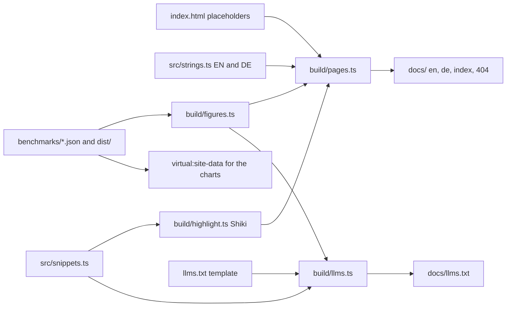

# Website architecture

## Purpose

The site shows what defuss-storage does by running it: every demo calls the
package build in a dedicated worker against the visitor's real OPFS. It is a
static site with no server code.

## Build

One page source becomes four static entry points.

Why prerender every route instead of one `index.html` behind a 404 fallback:
a static host then serves each URL as a real file, in its language and with
its view, before any script runs; a fallback page would arrive in English with
the host's 404 status and fix itself only in the browser. VERIFIED: (e2e)
`e2e/serve.mjs` serves `docs/` with directory index files and a `404.html`
for unknown paths, and every route renders its view, language and title.

Why relative asset URLs instead of root paths such as `/assets/`: the files
then also render when opened from disk, where a root path points at the top
of the file system. `build/pages.ts` rewrites them for each page's folder;
only `404.html` keeps root paths, since the host serves it at any depth.
Browsers refuse module scripts from `file://` (Chromium and WebKit; Firefox
runs them), so there the charts give way to a note and the demos stay
inactive. Links and the language select point at server paths such as
`/de/#demo`; from disk, a classic inline script maps them to the
prerendered files, since classic scripts run there in every engine. Why map at
runtime instead of building file links: served pages keep clean URLs for the
router and for sharing. VERIFIED: (e2e, three engines) pages opened from disk
apply the stylesheet, show their view, request nothing outside `docs/`, and
the language select and header links open the matching files.

Why build `llms.txt` from a template instead of keeping a finished file: its
code examples come from `src/snippets.ts` and its numbers from the benchmark
reports, the same sources as the page, so a new `make bench` or an API change
in the snippets updates what coding agents read too. VERIFIED: (unit test and
e2e) an unknown snippet or slot fails the build, and the served file carries
the measured figures with no unfilled slot.

Why generate the defuss-i18n templates instead of writing them: each string
would appear three times in the markup (visible text and one template per
language). The build writes them from one table and fails on a missing or
unused key.

## Runtime

- `src/main.ts` loads defuss-shadcn per component (core plus about 35
  components) instead of its all-in-one bundle. VERIFIED: (vite build) this
  cut the CSS from 1,185 kB to 396 kB and the entry JavaScript from 719 kB to
  244 kB before compression.
- `src/locale.ts` binds every `[data-i18n-component]` once with defuss-i18n.
  `/` has no language: the router sends visitors to `/en/` or `/de/` by an
  earlier explicit choice, else by `navigator.languages`.
- `src/router.ts` uses defuss-dom-router in history mode. Both views, home
  and not found, are in every HTML file; a navigation shows one view,
  switches the language and updates title and description without a reload.
  The benchmarks (chart and table, the live run, options, overload, large
  files and method) follow the demos on the home page. Why one page instead
  of a separate `/benchmarks/` route: the maintainer chose it on 2026-11-09,
  and every header and footer link then lands on a section of one document.
  VERIFIED: (e2e) the header, sheet and not-found links reach
  `#performance`, and the live run starts from `#run`.
- The type scale is one rule, `html { font-size: 125% }`: every size in
  `src/styles.css` is in rem. Breakpoints that must move with it, the header's
  menu switch and the demo tabs' columns, are container queries. Why not media
  queries: a media query measures rem against the browser default of 16px, a
  container query against the root, so only the latter grows with the type.
  VERIFIED: (site probe, Chromium) with media queries the header nav wrapped
  at 900 to 1100px wide and tab labels clipped at 1024 to 1512px; with
  container queries nothing overflows from 320 to 1920px in either language.
- `src/theme.ts` and an inline script in `<head>` apply the saved theme or the
  system preference before first paint.
- ECharts (core, bar, line and custom series, SVG renderer), Shiki for the
  playground editor and the WebGL shader load only when their section nears
  the viewport.

## Demos

Every demo except the playground has a backend bar over its view: Memory,
OPFS or Filesystem. The persistence, seek and backpressure demos run on Memory
and OPFS. A web page cannot open native files the way Node.js and Bun do, so
Filesystem shows a note that points to the Node.js setup, and the demo's
controls turn inert. In browsers with `showDirectoryPicker` (Chromium-based),
the note offers to pick a folder: the page hands the handle to the demo
worker, and the demos then write below `defuss-storage-demo/` in that folder
through `createDirectoryStorage`. The pick lasts for the session, since a stored
handle would need a new permission prompt after a reload anyway. The ownership
demo shows a note on Memory too, since each worker has its own memory and two
workers never share a file there. Why one demo on every backend instead of an
OPFS-only page: one handle API over all backends is what the package offers,
and switching shows where they differ, such as what a reload leaves of a
memory file. The choice lasts for the session, so a reload keeps it.
VERIFIED: (e2e, three engines) a line appended on Memory is gone after the
demo's reload, which says so; the OPFS line is still there; Filesystem shows
its note with the controls inert; seek and backpressure run on Memory; with
an OPFS folder standing in for the native picker, the persistence demo's bytes
land in the picked folder. The picker dialog itself is not automated.
VERIFIED: (site probe, Chromium 151) the seek demo writes 1,000,000 records to
a picked OPFS-backed folder in 5.2 s, against 1.4 s on OPFS sync handles, and
reads a random record in about 260 µs, against 2.6 µs.

`src/demos/storage.worker.ts` hosts the package in a dedicated worker, because
OPFS synchronous access handles exist only there. The page talks to it through
the typed messages in `src/demos/protocol.ts`. The ownership demo starts two
such workers, so each is its own Web Lock owner. Every demo's default settings
take the successful path (the backpressure defaults fit the limits, so all 64
calls are admitted), and each demo fits one screen: text and controls on the
left, the result on the right, with logs and the console scrolling inside their
box. VERIFIED: (e2e) each tab after its default run fits a 1440x900 viewport,
and the defaults end without an error. The playground runs each
script in a fresh worker and terminates it at the end or after 20 seconds,
which releases every lock the script took.

The seek demo writes up to a million variable-length records, each its own
awaited append and each ending in six hex digits derived from its number (so
every run writes the same file), and keeps the receipts as the index in its worker. A
defuss-shadcn virtual list renders only the rows on screen and asks the worker
for those, one `readExactly` per record at its indexed offset. Why a virtual
list instead of reading the file into a long page: the page then costs the
same for a million records as for twenty, which is the property the demo
shows. The rows share one fixed width, the longest record's, and scroll
sideways: rows recycle while the reader scrolls, and a width that followed the
rows on screen would move the sideways range under them. VERIFIED: (e2e, three
engines) the default run writes 1,000,000 records, the list shows records read
from the file, every record on screen reads in full when scrolled to the right
end, the seek field sits in a toolbar above the list, and a seek lands on its
record.

Demo results appear as defuss-shadcn toasts, piled top-right below the header,
and only after an interaction; the benchmark's progress line and the OPFS
notice stay in the page because they describe state, not events.

Runtime messages mark identifiers and error codes with backticks, and
`src/inline-code.ts` renders those spans as `<code>` in toasts, status lines,
the ownership log and tables. Why backticks instead of HTML in the messages:
the values filled into a message, such as an error text, stay text and cannot
become markup. ECharts labels take plain strings, so charts drop the marks.
A seek answers in the list itself, with the record highlighted, and shows no
toast, which would cover the list. VERIFIED: (e2e) the backpressure toast
renders `QUEUE_FULL` as `<code>`, and a seek adds no toast.

VERIFIED: (e2e, WebKit 26.5) an ephemeral browser context has no OPFS; the
worker then falls back to the memory adapter and the page says so.

## Operations

Build with `make site`; the result in `docs/` is committed and served by
GitHub Pages (`docs/CNAME` comes from `public/CNAME`). There is no service to
run. `make e2e` builds the site and runs the browser suite: every route in both
languages, light and dark themes, anchors, routing, the install toggle,
charts, the command palette, a prose scan, axe WCAG 2.1 A and AA checks, and
every demo in Chromium, Firefox and WebKit.

Two checks go beyond axe, because axe skips text over gradients and the
`aria-hidden` labels a diagram draws. The contrast check walks every visible
text node in both themes and every demo tab, measures it against the solid
background and each gradient stop behind it, and requires WCAG AA (4.5:1,
3:1 for large text) and at least 14px. The motion checks require rotating
headings to fade through their lines in order, and a language switch to
update a chart in place instead of drawing it again. VERIFIED: (e2e) all
pass; before the fixes, a switch redrew the overload chart over about 70
frames and the rolling headings passed their middle line twice per round.

## Security and privacy

- VERIFIED: (e2e, every route) the page makes no request outside its own
  origin: no analytics, no CDN; fonts, scripts and the portrait are served
  from the site itself. It sets no cookies.
- The demos write only to this origin's OPFS, in the namespaces
  `site-persist`, `site-owner`, `site-limits`, `site-bench` and `playground`.
  Nothing leaves the device.
- The playground runs the visitor's own code in a dedicated worker of this
  origin. Only `defuss-storage` and `defuss-storage/opfs` can be imported; it
  can do no more than code typed into this page's browser console, and less:
  a worker has no access to the page's DOM.
- `localStorage` keeps three preferences: theme, language and package manager.
